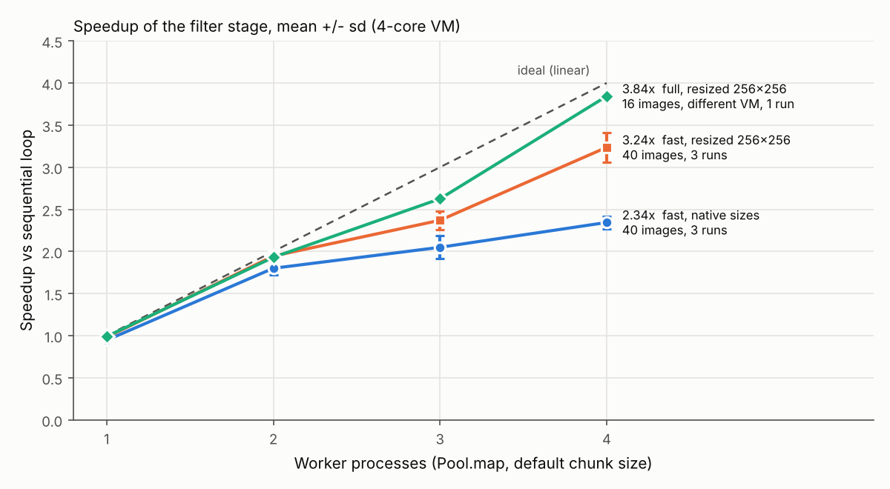

# Parallel MRI image pipeline

[](https://github.com/maryam843/parallel-mri-image-pipeline/actions/workflows/ci.yml)

A Python pipeline that runs six image filters and GLCM texture features over brain MRI images in parallel with `multiprocessing`, checks that the parallel output is identical to the sequential run, tests the features against baselines, and checks a public dataset's train/test split for near duplicates.

## Key results

- **Speedup:** 2.34x on 4 processes against the sequential loop (40 images at native sizes, 3 runs), and 3.24x when the same images are resized to 256x256, so uneven image sizes are the main limit. Parallel output was identical to sequential output for every filter in every configuration.
- **Texture features give no clear gain:** GLCM + random forest reaches 0.734 accuracy and raw pixels + SVM 0.750 (majority-class baseline 0.613), with exact and near copies kept in one fold. The best texture model (0.743) and the best raw-pixel model (0.751) are well inside the fold-to-fold spread.
- **Leakage in a public dataset:** in the larger 4-class dataset, 542 of 1,600 Testing images have a near-duplicate candidate in Training (431 with a pixel correlation of at least 0.99), including 358 of the 400 no-tumour images.
- **Part B models:** GLCM + random forest 0.872 and a small CNN 0.765 on the provided split; 0.816 and 0.705 on the 1058 Testing images without a near-duplicate candidate, a set that also has a different class mix.

## Speedup chart



**Tools:** Python, multiprocessing, NumPy, scikit-image, OpenCV, scikit-learn, PyTorch, pytest, Hypothesis, GitHub Actions

## Data

The images are not in this repo: they are medical images, the Part A licence is not an open one, and neither dataset is redistributed here. Credits and licences are in [CREDITS.md](CREDITS.md).

- **Part A:** "Brain MRI Images for Brain Tumor Detection" by Navoneel Chakrabarty, Kaggle: <https://www.kaggle.com/datasets/navoneel/brain-mri-images-for-brain-tumor-detection>. Kaggle lists the licence as "Data files © Original Authors". 253 images, 155 tumour (`yes/`) and 98 no tumour (`no/`), mixed file extensions and very different sizes. 25 files are exact copies (228 unique files), and 33 more pairs are near copies. Download it and put the two folders at `data/brain_tumor_dataset/yes` and `data/brain_tumor_dataset/no` (git-ignored). `python -m mri_pipeline verify-data` compares a local copy with the SHA-256 list in `docs/dataset_manifest.csv`.
- **Part B:** "Brain Tumor MRI Dataset" by Masoud Nickparvar, Kaggle, version 2: <https://www.kaggle.com/datasets/masoudnickparvar/brain-tumor-mri-dataset>. Licence CC BY 4.0. 7,200 images in 4 classes (glioma, meningioma, no tumour, pituitary), 1,400 per class in Training and 400 per class in Testing. Download it, keep it outside the repo and point `MRI_PART_B_DATA_DIR` at the folder that holds `Training/` and `Testing/`.

## Approach

1. **Profile first.** cProfile on 5 images: with the original Hessian setting (sigmas 1 to 99) the Hessian filter takes 99.1 % of the sequential time, and still 57.0 % in fast mode (sigmas 1 to 9). All six filters run on each image in turn, so the work is split by image, not by filter.
2. **One task per image.** `Pool.map` sends each image to a worker that runs entropy, Gaussian, Sobel, Gabor, Hessian and Prewitt. The worker functions live in `src/`, so they also work with the `spawn` start method (Windows, macOS).
3. **Measure scaling fairly.** A fixed, class-balanced subset of 40 unique images; the plain sequential loop against 1 to 4 processes, 3 interleaved runs, timed including pool start-up. Chunk sizes and `imap_unordered` are compared, and every parallel output is checked array by array against the sequential one.
4. **Features.** Each filter output is min-max rescaled to 0-255, then 6 GLCM properties x 4 angles on the input and the 6 filtered images give 168 features per image. A direct `uint8` cast is kept only as an ablation, because it inverts or wraps some filter outputs.
5. **Evaluate without leakage.** Stratified 5-fold cross-validation x 3 seeds, where each group joins exact copies (same SHA-256) and near copies (dHash and pHash both within 4 bits), giving 207 groups for 253 images. Baselines: the majority class and the same three models on raw 64x64 pixels.
6. **Part B.** The same filters and features on the 4-class dataset: count check, exact and near-duplicate check between Training and Testing with a pixel check of each candidate, then GLCM + random forest and a small CNN (128x128 grayscale, 20 epochs, CPU, deterministic training) scored on the provided Testing split and on Testing without the flagged images.
7. **Numbers come from files.** The tables below are generated from `results/`, and `scripts/check_readme_claims.py` (run in CI) fails if a number in this README or in `docs/RESULTS.md` cannot be found in `results/`.

## Results

### Classifiers vs baselines

<!-- BEGIN:ml -->
253 images, 5-fold stratified CV grouped by exact and near copies, seeds 0, 1, 2, mean +/- sd over 15 folds (`results/ml_cv_summary.csv`)

| Features | Model | Accuracy | Macro F1 | Tumour recall |
|---|---|---:|---:|---:|
| none | Majority class | 0.613 +/- 0.006 | 0.380 +/- 0.002 | 1.000 +/- 0.000 |
| raw pixels 64x64 | LogReg | 0.704 +/- 0.094 | 0.678 +/- 0.106 | 0.776 +/- 0.115 |
| raw pixels 64x64 | SVM (RBF) | 0.750 +/- 0.060 | 0.715 +/- 0.075 | 0.882 +/- 0.074 |
| raw pixels 64x64 | Random forest | 0.751 +/- 0.067 | 0.726 +/- 0.077 | 0.847 +/- 0.073 |
| GLCM, min-max rescale | LogReg | 0.726 +/- 0.074 | 0.698 +/- 0.082 | 0.834 +/- 0.068 |
| GLCM, min-max rescale | SVM (RBF) | 0.728 +/- 0.076 | 0.696 +/- 0.085 | 0.847 +/- 0.088 |
| GLCM, min-max rescale | Random forest | 0.734 +/- 0.076 | 0.712 +/- 0.080 | 0.822 +/- 0.099 |
| GLCM, direct uint8 cast (ablation) | LogReg | 0.743 +/- 0.048 | 0.715 +/- 0.055 | 0.852 +/- 0.063 |
| GLCM, direct uint8 cast (ablation) | SVM (RBF) | 0.710 +/- 0.061 | 0.675 +/- 0.063 | 0.843 +/- 0.088 |
| GLCM, direct uint8 cast (ablation) | Random forest | 0.693 +/- 0.054 | 0.665 +/- 0.056 | 0.798 +/- 0.080 |
<!-- END:ml -->

The texture features do not give a clear gain over raw pixels: every model beats the majority baseline, and the gaps between the GLCM and raw-pixel models are smaller than the fold-to-fold spread.

### Part B: GLCM + random forest vs a small CNN

<!-- BEGIN:part_b_models -->
Trained on the Training split, seeds 0, 1, 2, mean +/- sd over seeds (`results/part_b/per_class_summary.csv`)

| Model | Test set | Test images | Accuracy | Macro F1 |
|---|---|---:|---:|---:|
| GLCM + random forest | Testing split as provided | 1600 | 0.872 +/- 0.002 | 0.868 +/- 0.002 |
| Small CNN | Testing split as provided | 1600 | 0.765 +/- 0.092 | 0.755 +/- 0.109 |
| GLCM + random forest | Testing without cross-split duplicate candidates | 1058 | 0.816 +/- 0.002 | 0.764 +/- 0.001 |
| Small CNN | Testing without cross-split duplicate candidates | 1058 | 0.705 +/- 0.142 | 0.692 +/- 0.132 |
<!-- END:part_b_models -->

The random forest is ahead of the small CNN and far more stable across seeds. Glioma is the hardest class for the random forest (recall 0.673); for the CNN, glioma and pituitary tie at 0.601. Only 42 of the 400 no-tumour Testing images are left in the second test set, so its lower scores mix fewer near duplicates with a different class mix.

**Speedups in detail:** chunk size 1 raises the 4-process speedup to 2.88x. In full mode (Hessian sigmas 1 to 99, 16 images, one run each) the speedup is 1.90x at native sizes and 3.84x at 256x256, the second on a different VM type. On a 6-core, 12-thread laptop the Part B filter stage (200 images at 256x256) reaches 3.48x with 6 processes and 4.69x with 10. All tables, figures and the reasoning behind each number: [docs/RESULTS.md](docs/RESULTS.md). Design decisions: [docs/DECISIONS.md](docs/DECISIONS.md).

## Limitations

- Part A is small (253 images, 207 copy groups) and the models use default settings without tuning, so gaps of a few points between models are not meaningful.
- The Part B provided split shares near duplicates between Training and Testing, so 0.872 overstates performance on new images, and the second test set is not a clean replacement because its class mix differs. The CNN is a small baseline trained from scratch and varies a lot by seed (0.765 +/- 0.092).
- Timings come from three machines (two 4-vCPU cloud VM types and a 6-core laptop) and change with the machine. The full-mode speedups are single runs on 16 images.
- Not a medical tool. Each part uses one public dataset with no external validation, and nothing here should be used to make decisions about a patient.

## How to run

Python 3.12. From the repository root:

```bash
python -m venv .venv
source .venv/bin/activate            # Windows: .venv\Scripts\activate
pip install -r requirements-dev.txt --extra-index-url https://download.pytorch.org/whl/cpu
pip install -e . --no-deps
```

Without the real data (synthetic images, runs anywhere):

```bash
python -m mri_pipeline make-synthetic --out data_synthetic --per-class 8
python -m mri_pipeline run-scaling --data-dir data_synthetic --out-dir results/scratch --images 8 --processes 1 2 --repeats 1
python -m mri_pipeline run-ml --fast --data-dir data_synthetic --out-dir results/scratch --seeds 0 --folds 3
```

With the Part A images in `data/brain_tumor_dataset/`. Every output goes to the git-ignored `results/scratch/`, so the committed `results/` stays the reference:

```bash
python -m mri_pipeline verify-data
python -m mri_pipeline profile --full --images 5 --out-dir results/scratch
python -m mri_pipeline run-scaling --fast --images 40 --processes 1 2 3 4 --repeats 3 --out-dir results/scratch
python -m mri_pipeline run-scaling --fast --images 40 --processes 1 2 3 4 --repeats 3 --no-strategies --resize 256 --tag resized_256 --out-dir results/scratch
python -m mri_pipeline run-ml --fast --seeds 0 1 2 --out-dir results/scratch
python scripts/make_figures.py --results results/scratch --out results/scratch/figures
```

Part B (`MRI_PART_B_OUT` must be an absolute path; `run_part_b.py` also re-saves the notebook, and `git checkout notebooks/` restores it):

```bash
export MRI_PART_B_LICENCE=CC-BY-4.0
export MRI_PART_B_DATA_DIR=/path/to/folder/with/Training/and/Testing
export MRI_PART_B_OUT="$PWD/results/scratch"
python scripts/run_part_b.py --torch-threads 4
python scripts/check_duplicate_candidates.py --results results/scratch/results/part_b
python scripts/run_part_b_scaling.py --results results/scratch/part_b_scaling --figures results/scratch/part_b_scaling_figures
```

Tests and checks, as CI runs them:

```bash
ruff check . && ruff format --check .
pytest --cov --cov-fail-under=85
MRI_START_METHOD=spawn pytest
python scripts/check_readme_claims.py
python scripts/pii_scan.py --history
```

`python -m mri_pipeline --help` lists every command and option.

## Repo structure

```
src/mri_pipeline/   filters, GLCM features, parallel runners, CV, Part B checks, CNN, CLI
scripts/            run wrappers, figures, README tables, claims check, PII scan
tests/              unit, property and integration tests on synthetic images
notebooks/          walkthrough.ipynb, part_b_larger_dataset_colab.ipynb
results/            committed CSV/JSON results (Part B in results/part_b/)
figures/            charts drawn from results/
docs/               RESULTS.md, DECISIONS.md, dataset_manifest.csv
CREDITS.md          supplied code, datasets, libraries
```

## Licence and credits

My code is under the MIT licence ([LICENSE](LICENSE)). The six filter calls and their parameters, and the `compute_glcm_features` helper, were supplied with the original exercise; `src/mri_pipeline/filters.py` and the GLCM part of `src/mri_pipeline/features.py` are based on them, those supplied parts remain the work of their authors, and the header of each file lists what was changed. Full credits: [CREDITS.md](CREDITS.md).

- Navoneel Chakrabarty, "Brain MRI Images for Brain Tumor Detection", Kaggle (Part A data, not redistributed).
- Masoud Nickparvar, "Brain Tumor MRI Dataset", Kaggle, version 2, CC BY 4.0, built from the figshare, SARTAJ and Br35H datasets (Part B data, not redistributed).
- Libraries: NumPy, SciPy, scikit-image, scikit-learn, OpenCV, matplotlib and PyTorch.
