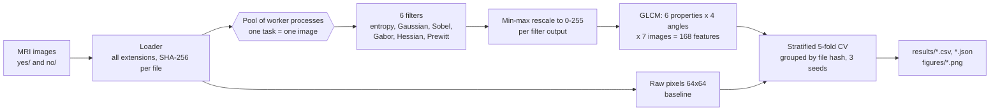
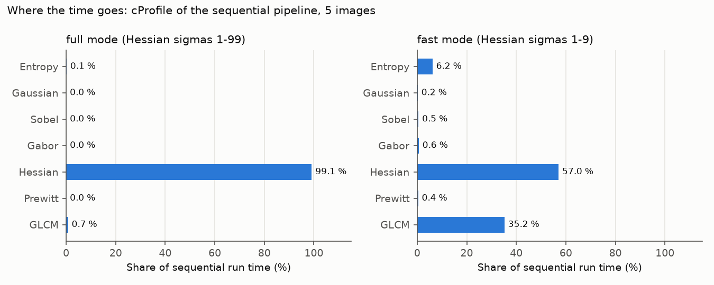
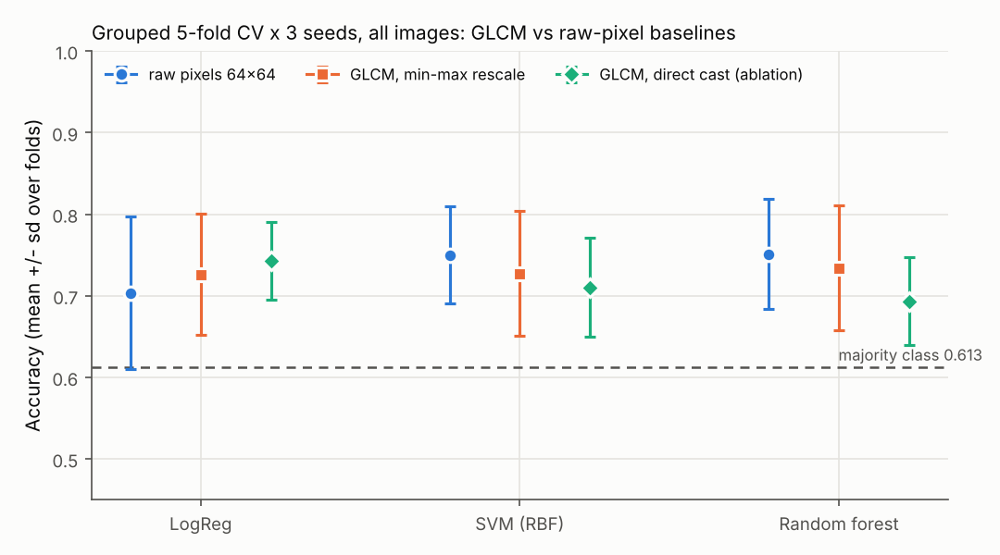
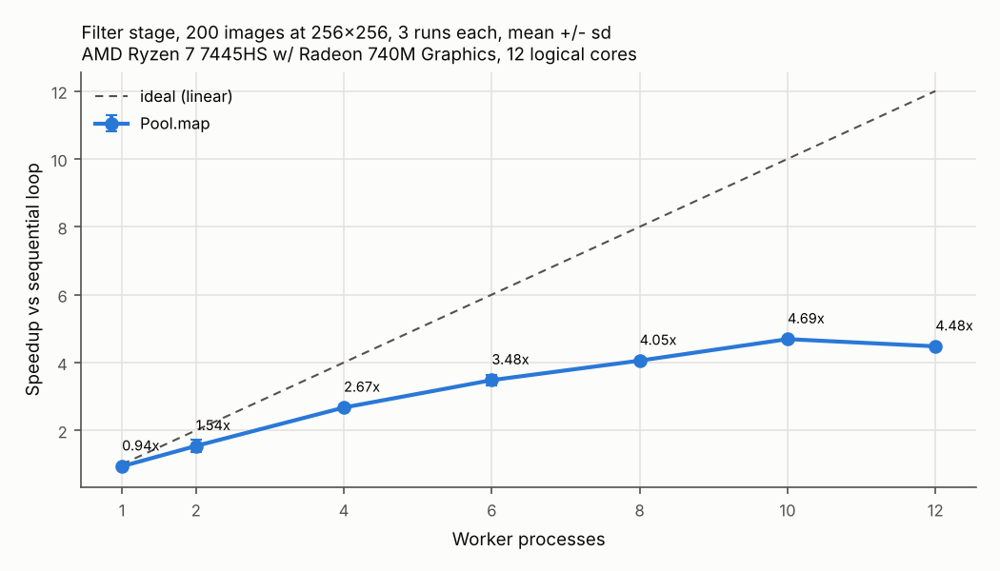
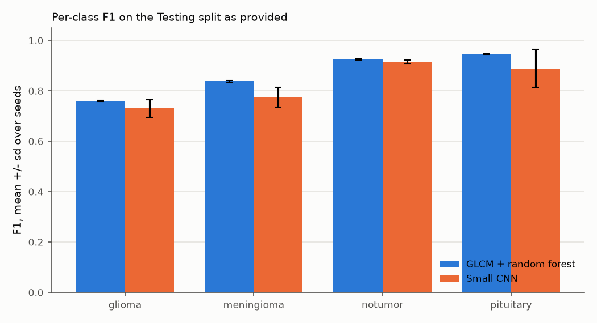

# Parallel MRI image pipeline

[](https://github.com/maryam843/parallel-mri-image-pipeline/actions/workflows/ci.yml)
<!-- While the repo is private, this badge only renders for people who have access to it. -->

Built for the DSAI3202 Parallel & Distributed Computing course at UDST.

I take brain MRI images through six image filters and a texture-feature step, run that work in parallel with Python `multiprocessing`, and measure how much faster it gets and whether the features are any good.

## In plain English

- **What it is:** a Python pipeline that loads brain MRI images, applies 6 filters to each one, turns the results into texture numbers (GLCM features), and trains simple classifiers on them.
- **The problem:** the filtering is slow, so I split the work across CPU cores. The real question is how much time that saves, and why not more.
- **How it works:** images in, then 6 filters per image in parallel worker processes, then 168 texture features per image, then cross-validated models compared with simple baselines. Out come CSV/JSON results, tables and charts.
- **Main result:** on a 4-core machine the parallel version gives identical outputs and runs 2.34x faster on the real images, and up to 3.84x when every image has the same size, because very uneven image sizes are the main limit. The texture features do not beat a simple model on raw pixels (0.752 vs 0.803 accuracy).
- **Part B:** on a larger public 4-class dataset, 542 of 1,600 Testing images have a near-duplicate candidate in Training (431 at pixel correlation >= 0.99), concentrated in the no-tumour class (358 of 400). On the provided split, GLCM + random forest reaches 0.872 accuracy and a small CNN 0.833; both are lower on the reduced test set (0.815 and 0.789), which also has a different class mix. The best filter speedup is 4.69x at 10 processes on a 6-core laptop (see [Part B](#part-b-a-larger-4-class-dataset)).
- **Why it matters:** it shows how I find the slow part of a data pipeline, parallelise it safely, and check my own numbers before quoting them.

> Demo video: **placeholder**, to be recorded by me later (under 10 MB). Until then, the walkthrough notebook `notebooks/walkthrough.ipynb` shows every step.

## The problem

The course gave six scikit-image filters (entropy, Gaussian, Sobel, Gabor, Hessian, Prewitt) to apply to every MRI image, followed by GLCM texture features and three classifiers. With the course setting for the Hessian filter (sigmas 1-99), one image at a time takes about 35 s per image in my profile, so the whole dataset takes over an hour. The task was to make it faster with parallel processing and still get a working classifier.

## Data

- **Source:** the public Kaggle dataset "Brain MRI Images for Brain Tumor Detection" by Navoneel Chakrabarty: <https://www.kaggle.com/datasets/navoneel/brain-mri-images-for-brain-tumor-detection>. Please cite that page if you use it.
- **Size:** 253 images, 155 in `yes/` (tumour) and 98 in `no/`. Mixed file types (`.jpg`, `.JPG`, `.jpeg`, `.png`) and very different image sizes.
- **Duplicates:** 25 files are exact byte copies of other files (228 unique files, 22 duplicate groups, none across classes).
- **Licence:** the licence is not clearly stated on the source page, so **the images are not included in this repo** and are not redistributed. They are medical images, so I treat them as sensitive.
- **Get it:** download the dataset from Kaggle and put the two folders at `data/brain_tumor_dataset/yes` and `data/brain_tumor_dataset/no` (the `data/` folder is git-ignored).
- **Check your copy:** `docs/dataset_manifest.csv` lists every file name with its SHA-256 and class. Run `python -m mri_pipeline verify-data` to compare your copy with it.

## Method



1. **Profile first.** cProfile on 5 images shows where the time goes.
2. **Parallelise per image.** Each image is independent, so one task is one image with all six filters. The worker functions live in `src/mri_pipeline/`, so they also work with the `spawn` start method (Windows, macOS).
3. **Measure scaling.** A fixed, class-balanced subset of 40 unique images; sequential loop vs `Pool.map` on 1, 2, 3 and 4 processes; 3 runs each, interleaved; mean +/- sd. I also compare chunk sizes and `imap_unordered`, and check that parallel outputs are identical to sequential outputs for every filter.
4. **Evaluate the features honestly.** All 253 images, stratified 5-fold cross-validation where duplicate files always stay in the same fold, 3 seeds, three models, compared with a majority-class baseline and the same models on raw pixels.

Modes: `--fast` (default) uses Hessian sigmas 1-9; `--full` uses sigmas 1-99 as in the course setting. Every table says which mode it used. Fast mode changes the Hessian output, so fast-mode and full-mode features and timings are not the same.

## Results

### Where the time goes

<!-- BEGIN:profile_full -->
Sequential pipeline, 5 images, full mode, cProfile cumulative time (`results/profile_full.csv`)

| Stage | Total (s) | Per image (s) | Share |
|---|---:|---:|---:|
| Entropy | 0.26 | 0.05 | 0.1 % |
| Gaussian | 0.01 | 0.00 | 0.0 % |
| Sobel | 0.02 | 0.00 | 0.0 % |
| Gabor | 0.03 | 0.01 | 0.0 % |
| Hessian | 171.73 | 34.35 | 99.1 % |
| Prewitt | 0.02 | 0.00 | 0.0 % |
| GLCM (7 filtered images x 24 features per image) | 1.27 | 0.25 | 0.7 % |
| Other (loop, dict building, profiler overhead) | 0.00 | 0.00 | 0.0 % |
| **Total** | 173.33 | 34.67 | 100.0 % |
<!-- END:profile_full -->

<!-- BEGIN:profile_fast -->
Sequential pipeline, 5 images, fast mode, cProfile cumulative time (`results/profile_fast.csv`)

| Stage | Total (s) | Per image (s) | Share |
|---|---:|---:|---:|
| Entropy | 0.26 | 0.05 | 6.2 % |
| Gaussian | 0.01 | 0.00 | 0.2 % |
| Sobel | 0.02 | 0.00 | 0.5 % |
| Gabor | 0.03 | 0.01 | 0.6 % |
| Hessian | 2.37 | 0.47 | 57.0 % |
| Prewitt | 0.01 | 0.00 | 0.4 % |
| GLCM (7 filtered images x 24 features per image) | 1.46 | 0.29 | 35.2 % |
| Other (loop, dict building, profiler overhead) | 0.00 | 0.00 | 0.0 % |
| **Total** | 4.15 | 0.83 | 100.0 % |
<!-- END:profile_fast -->



With the course setting of sigmas 1-99, the Hessian filter takes 99.1 % of the time. Even in fast mode it is the biggest stage (57.0 %). All six filters run on the same image one after another, so splitting the work by image (not by filter) keeps every worker busy with one whole image.

### Scaling

<!-- BEGIN:scaling -->
Task `filters`: 40 images, fast mode, native sizes, largest image = 18.2 % of all pixels, 3 run(s) each, 4 cores (Intel(R) Xeon(R) Processor @ 2.80GHz), start method `fork` (`results/scaling_summary.csv`)

| Configuration | Processes | Time (s), mean +/- sd | Speedup | Efficiency |
|---|---:|---:|---:|---:|
| Sequential loop (no pool) | 1 | 42.46 +/- 0.88 | 1.00x | 1.00 |
| Pool.map | 1 | 44.93 +/- 2.06 | 0.95x +/- 0.04 | 0.95 |
| Pool.map | 2 | 23.62 +/- 1.02 | 1.80x +/- 0.08 | 0.90 |
| Pool.map | 3 | 20.78 +/- 1.45 | 2.05x +/- 0.14 | 0.68 |
| Pool.map | 4 | 18.13 +/- 0.59 | 2.34x +/- 0.08 | 0.59 |
<!-- END:scaling -->


On the images at their native sizes, `Pool.map` reaches 2.34x on 4 processes (efficiency 0.59). A pool with one process is slower than the plain loop (0.95x): that is the cost of starting the pool and sending seven filtered arrays per image back to the parent. The bigger limit is that the images have very different sizes. In this subset the largest image alone has 18.2 % of all pixels, so the work cannot be split into four equal parts.

<!-- BEGIN:strategies -->
| Strategy | Processes | Chunk size used | Time (s), mean +/- sd | Speedup |
|---|---:|---:|---:|---:|
| Pool.map, chunksize auto | 4 | 3 | 17.83 +/- 0.27 | 2.38x |
| Pool.map, chunksize 1 | 4 | 1 | 14.72 +/- 0.08 | 2.88x |
| imap_unordered, chunksize 1 | 4 | 1 | 14.93 +/- 0.14 | 2.84x |
| imap_unordered, chunksize auto | 4 | 3 | 17.95 +/- 0.27 | 2.37x |
<!-- END:strategies -->

The chunk size matters more than `map` vs `imap_unordered`. With 40 images and 4 processes, `Pool.map` sends chunks of 3 images, so one worker can get several big images while the others finish early and wait. With chunksize 1, each worker takes the next image as soon as it is free: 2.88x instead of 2.38x. `imap_unordered` with the same chunk size gives about the same speed (2.84x); it only changes the order in which results come back.

Two extra runs separate the causes. First, the same 40 images resized to 256x256, so every task is the same size. Second, a worker that also does the GLCM step and returns only 168 numbers per image instead of seven arrays:

<!-- BEGIN:scaling_resized_256 -->
Task `filters`: 40 images, fast mode, resized to 256x256, largest image = 2.5 % of all pixels, 3 run(s) each, 4 cores (Intel(R) Xeon(R) Processor @ 2.80GHz), start method `fork` (`results/scaling_summary_resized_256.csv`)

| Configuration | Processes | Time (s), mean +/- sd | Speedup | Efficiency |
|---|---:|---:|---:|---:|
| Sequential loop (no pool) | 1 | 14.35 +/- 0.08 | 1.00x | 1.00 |
| Pool.map | 1 | 14.61 +/- 0.12 | 0.98x +/- 0.01 | 0.98 |
| Pool.map | 2 | 7.38 +/- 0.07 | 1.95x +/- 0.02 | 0.97 |
| Pool.map | 3 | 6.06 +/- 0.29 | 2.37x +/- 0.11 | 0.79 |
| Pool.map | 4 | 4.44 +/- 0.23 | 3.24x +/- 0.18 | 0.81 |
<!-- END:scaling_resized_256 -->

<!-- BEGIN:scaling_features_task -->
Task `features`: 40 images, fast mode, native sizes, largest image = 18.2 % of all pixels, 3 run(s) each, 4 cores (Intel(R) Xeon(R) Processor @ 2.80GHz), start method `fork` (`results/scaling_summary_features_task.csv`)

| Configuration | Processes | Time (s), mean +/- sd | Speedup | Efficiency |
|---|---:|---:|---:|---:|
| Sequential loop (no pool) | 1 | 52.48 +/- 1.04 | 1.00x | 1.00 |
| Pool.map | 1 | 52.73 +/- 0.95 | 0.99x +/- 0.02 | 0.99 |
| Pool.map | 2 | 27.88 +/- 0.56 | 1.88x +/- 0.04 | 0.94 |
| Pool.map | 3 | 23.75 +/- 0.69 | 2.21x +/- 0.06 | 0.74 |
| Pool.map | 4 | 20.48 +/- 0.17 | 2.56x +/- 0.02 | 0.64 |
<!-- END:scaling_features_task -->

With equal-sized images the pool reaches 3.24x on 4 processes, so uneven image sizes cost the most. Returning 168 numbers instead of seven arrays brings the one-process pool to 0.99x of the plain loop (instead of 0.95x) and gives 2.56x at 4 processes, but the unequal image sizes still limit it.

Full mode (Hessian sigmas 1-99) on a 16-image subset, one run each (this takes about an hour, so I did not repeat it):

<!-- BEGIN:scaling_full_subset -->
Task `filters`: 16 images, full mode, native sizes, largest image = 46.1 % of all pixels, 1 run(s) each, 4 cores (Intel(R) Xeon(R) Processor @ 2.10GHz), start method `fork` (`results/scaling_summary_full_subset.csv`)

| Configuration | Processes | Time (s), mean +/- sd | Speedup | Efficiency |
|---|---:|---:|---:|---:|
| Sequential loop (no pool) | 1 | 832.03 (1 run) | 1.00x | 1.00 |
| Pool.map | 1 | 820.86 (1 run) | 1.01x (1 run) | 1.01 |
| Pool.map | 2 | 566.31 (1 run) | 1.47x (1 run) | 0.73 |
| Pool.map | 3 | 507.99 (1 run) | 1.64x (1 run) | 0.55 |
| Pool.map | 4 | 440.28 (1 run) | 1.89x (1 run) | 0.47 |
<!-- END:scaling_full_subset -->

<!-- BEGIN:scaling_full_resized_256 -->
Task `filters`: 16 images, full mode, resized to 256x256, largest image = 6.2 % of all pixels, 1 run(s) each, 4 cores (Intel(R) Xeon(R) Processor @ 2.10GHz), start method `fork` (`results/scaling_summary_full_resized_256.csv`)

| Configuration | Processes | Time (s), mean +/- sd | Speedup | Efficiency |
|---|---:|---:|---:|---:|
| Sequential loop (no pool) | 1 | 215.81 (1 run) | 1.00x | 1.00 |
| Pool.map | 1 | 218.06 (1 run) | 0.99x (1 run) | 0.99 |
| Pool.map | 2 | 111.85 (1 run) | 1.93x (1 run) | 0.96 |
| Pool.map | 3 | 82.22 (1 run) | 2.62x (1 run) | 0.88 |
| Pool.map | 4 | 56.15 (1 run) | 3.84x (1 run) | 0.96 |
<!-- END:scaling_full_resized_256 -->

In full mode each image does much more work for every byte sent back, so pool overhead almost disappears. With equal-sized images, 4 processes give 3.84x (efficiency 0.96). With native sizes, the same 16 images give only 1.89x, because one image (1427x1275 pixels) has 46.1 % of all pixels and a pool cannot finish before its biggest task.

Why the speedups differ: 2.34x and 3.84x differ in four ways at once. First, the mix of image sizes: 2.34x (`results/scaling_summary.csv`) uses images at their native, very different sizes, and the largest one alone has 18.2 % of all pixels (`results/scaling_meta.json`). Each task is one whole image, so the pool cannot finish before that image is done. 3.84x uses images resized to 256x256, so every task costs about the same. Second, the mode: 2.34x is fast mode (Hessian sigmas 1-9) and 3.84x is full mode (sigmas 1-99), so each task does far more work in full mode and the cost of starting the pool and sending results back is a smaller share of the total. Third, the image count: 40 images vs 16. Fourth, the machine: the fast-mode scaling tables (and both profiles) ran on `Intel(R) Xeon(R) Processor @ 2.80GHz`, the two full-mode scaling tables on `Intel(R) Xeon(R) Processor @ 2.10GHz` (`machine.cpu_model` in `results/scaling_meta.json`, `results/scaling_meta_resized_256.json`, `results/scaling_meta_full_resized_256.json` and `results/scaling_meta_full_subset.json`). Both were 4-vCPU cloud virtual machines, but not the same one. The fast-mode run on the same 40 images resized to 256x256 (`results/scaling_summary_resized_256.csv`) keeps the mode, the image count and the CPU model the same and gives 3.24x. Resizing also makes each image smaller, so that step changes the size mix and the work per task together; even so, the speedup went up although each task got cheaper, which points to the uneven sizes. The step from 3.24x to 3.84x changes the mode, the image count and the machine together, and I have no run that separates those effects, so I cannot say how much of that step comes from full mode itself. Also, 3.84x (`results/scaling_summary_full_resized_256.csv`) is a single run per configuration: the file has runs = 1, so its table says "1 run" instead of giving a spread. 2.34x and 3.24x are means of 3 runs.

Parallel outputs were identical to sequential outputs (`np.array_equal` and `np.allclose`) for every filter in every configuration (`results/parallel_equivalence*.json`).

### Classifiers vs baselines

<!-- BEGIN:ml -->
253 images, 5-fold stratified CV grouped by file hash, seeds 0, 1, 2, mean +/- sd over 15 folds (`results/ml_cv_summary.csv`)

| Features | Model | Accuracy | Macro F1 | Tumour recall |
|---|---|---:|---:|---:|
| none | Majority class | 0.613 +/- 0.006 | 0.380 +/- 0.002 | 1.000 +/- 0.000 |
| raw pixels 64x64 | LogReg | 0.757 +/- 0.041 | 0.741 +/- 0.042 | 0.817 +/- 0.087 |
| raw pixels 64x64 | SVM (RBF) | 0.803 +/- 0.056 | 0.781 +/- 0.060 | 0.914 +/- 0.079 |
| raw pixels 64x64 | Random forest | 0.799 +/- 0.056 | 0.782 +/- 0.062 | 0.882 +/- 0.057 |
| GLCM, min-max rescale | LogReg | 0.747 +/- 0.058 | 0.722 +/- 0.067 | 0.845 +/- 0.057 |
| GLCM, min-max rescale | SVM (RBF) | 0.737 +/- 0.063 | 0.707 +/- 0.073 | 0.850 +/- 0.072 |
| GLCM, min-max rescale | Random forest | 0.752 +/- 0.070 | 0.731 +/- 0.075 | 0.834 +/- 0.094 |
| GLCM, direct uint8 cast (ablation) | LogReg | 0.759 +/- 0.062 | 0.733 +/- 0.067 | 0.865 +/- 0.088 |
| GLCM, direct uint8 cast (ablation) | SVM (RBF) | 0.717 +/- 0.068 | 0.684 +/- 0.081 | 0.837 +/- 0.075 |
| GLCM, direct uint8 cast (ablation) | Random forest | 0.721 +/- 0.058 | 0.691 +/- 0.063 | 0.834 +/- 0.081 |
<!-- END:ml -->



**Plain conclusion:** the GLCM texture features do **not** beat raw pixels. The best raw-pixel models (SVM 0.803, random forest 0.799) are ahead of every GLCM model (0.717 to 0.759). All models beat the majority-class baseline (0.613). Extracting the GLCM features for all 253 images took 107.025 s on 4 processes in fast mode.

Rescale ablation (direct uint8 cast vs per-filter min-max): the rows marked "direct uint8 cast (ablation)" feed the GLCM step with `(image * 255).astype(np.uint8)` instead of the min-max rescale. Min-max is ahead for the SVM (0.737 vs 0.717) and the random forest (0.752 vs 0.721) but not for logistic regression (0.747 vs 0.759), and all those differences are inside one standard deviation.

How much the duplicate files would have flattered the scores (same models, plain stratified folds that ignore duplicates):

<!-- BEGIN:leakage -->
| Features | Model | Accuracy, grouped CV | Accuracy, leaky CV | Difference |
|---|---|---:|---:|---:|
| raw pixels 64x64 | LogReg | 0.757 | 0.761 | +0.004 |
| raw pixels 64x64 | SVM (RBF) | 0.803 | 0.809 | +0.006 |
| raw pixels 64x64 | Random forest | 0.799 | 0.820 | +0.020 |
| GLCM, min-max rescale | LogReg | 0.747 | 0.740 | -0.007 |
| GLCM, min-max rescale | SVM (RBF) | 0.737 | 0.744 | +0.008 |
| GLCM, min-max rescale | Random forest | 0.752 | 0.776 | +0.024 |
| GLCM, direct uint8 cast (ablation) | LogReg | 0.759 | 0.768 | +0.009 |
| GLCM, direct uint8 cast (ablation) | SVM (RBF) | 0.717 | 0.727 | +0.010 |
| GLCM, direct uint8 cast (ablation) | Random forest | 0.721 | 0.748 | +0.028 |
<!-- END:leakage -->

The random forest gains the most from leaked duplicates (see the Difference column), because it can memorise an exact copy it saw in training.

## Part B: a larger 4-class dataset

Here I run the same pipeline on the "Brain Tumor MRI Dataset" (Version 2, Kaggle, see Credits): glioma, meningioma, pituitary and no tumour, with a Training/Testing split provided by the author. Everything ran headless on my laptop CPU through `notebooks/part_b_larger_dataset_colab.ipynb` (`python scripts/run_part_b.py`). The main result uses the provided split as it is. The same notebook still runs on Colab.

**Not a medical tool.** These are exercise models on one public dataset. Nothing here should be used to make decisions about a patient.

### Count check

<!-- BEGIN:part_b_counts -->
Images found vs expected: 7200 of 7200, differences: 0 (`results/part_b/dataset_counts.json`)

| Split | glioma | meningioma | notumor | pituitary | Total |
|---|---:|---:|---:|---:|---:|
| Training | 1400 | 1400 | 1400 | 1400 | 5600 |
| Testing | 400 | 400 | 400 | 400 | 1600 |
<!-- END:part_b_counts -->

### Duplicate check

The dataset page says duplicates were removed and the train/test overlap was eliminated. I checked both. Exact copies use SHA-256 of the file bytes. Near duplicates use two 64-bit perceptual hashes (dHash and pHash); a pair is a candidate when both hashes are within 4 bits.

<!-- BEGIN:part_b_duplicates -->
64-bit perceptual hashes, pairs counted by Hamming distance (`results/part_b/duplicates.json`)

| Check | Within Training | Within Testing | Across splits |
|---|---:|---:|---:|
| Exact copies (SHA-256): extra copies inside the split | 171 | 16 | n/a |
| Exact copies (SHA-256): Testing files with a copy in Training | n/a | n/a | 0 |
| dHash pairs within 4 bits | 9325 | 884 | 4990 |
| pHash pairs within 4 bits | 3432 | 416 | 2022 |
| Candidate pairs (dHash and pHash both within 4 bits) | 2620 | 354 | 1658 |
| Candidate pairs with different class labels | 0 | 4 | 4 |
| Testing images with a candidate in Training | n/a | n/a | 542 |
<!-- END:part_b_duplicates -->

No file is shared byte for byte between Training and Testing, but 171 extra exact copies remain inside Training and 16 inside Testing. The near-duplicate check finds much more: 542 Testing images have a candidate in Training. To make sure these are not just hash collisions, I compared every candidate pair pixel by pixel at 128x128 (`scripts/check_duplicate_candidates.py`, `results/part_b/duplicate_candidates_pixel.json`): across the splits the median correlation of a pair is 0.9956, and 431 Testing images have a Training partner with a correlation of at least 0.99. I also looked at 2 pairs by eye: the median pair looks like the same image, and the weakest across-split pair looks like a neighbouring slice of the same scan. 4 cross-split candidate pairs and 4 pairs within Testing have different class labels, which may point to labelling errors; I did not check those pairs by eye. So exact copies across the split are gone, but a lot of near-duplicate overlap between Training and Testing remains.

### Speedup of the filter stage

<!-- BEGIN:part_b_scaling -->
Task `filters`: 200 images, fast mode, resized to 256x256, largest image = 0.5 % of all pixels, 3 run(s) each, 12 logical cores, 6 physical (AMD Ryzen 7 7445HS w/ Radeon 740M Graphics), start method `spawn` (`results/part_b/scaling_summary.csv`)

| Configuration | Processes | Time (s), mean +/- sd | Speedup | Efficiency |
|---|---:|---:|---:|---:|
| Sequential loop (no pool) | 1 | 78.33 +/- 5.97 | 1.00x | 1.00 |
| Pool.map | 1 | 83.45 +/- 4.73 | 0.94x +/- 0.05 | 0.94 |
| Pool.map | 2 | 51.28 +/- 5.70 | 1.54x +/- 0.18 | 0.77 |
| Pool.map | 4 | 29.32 +/- 0.78 | 2.67x +/- 0.07 | 0.67 |
| Pool.map | 6 | 22.53 +/- 1.08 | 3.48x +/- 0.17 | 0.58 |
| Pool.map | 8 | 19.32 +/- 0.15 | 4.05x +/- 0.03 | 0.51 |
| Pool.map | 10 | 16.71 +/- 0.12 | 4.69x +/- 0.03 | 0.47 |
| Pool.map | 12 | 17.50 +/- 0.13 | 4.48x +/- 0.03 | 0.37 |
<!-- END:part_b_scaling -->



This benchmark was run on its own with `python scripts/run_part_b_scaling.py`, using the notebook's settings; the free memory and the programs using the most memory at the start are in `results/part_b/scaling_environment.json`. On this laptop the pool reaches 3.48x with 6 processes, one per physical core, and 4.69x with 10. With 12 it is a little lower (4.48x): beyond 6 processes the workers share physical cores, so each extra process adds less. Each worker gets one BLAS thread (see `docs/DECISIONS.md`). Parallel outputs were identical to sequential outputs (`results/part_b/parallel_equivalence.json`). An earlier run inside the notebook, with more programs open and less free memory, had a much larger spread at 6 to 10 processes; its files are kept in `results/part_b/scaling_first_run/`.

### GLCM + random forest vs a small CNN

Both models are trained on the whole Training split and scored on the Testing split, three times with seeds 0, 1 and 2. The GLCM features come from 256x256 images (fast mode, 168 features). The random forest has 300 trees. The CNN has four convolution blocks and 97908 parameters, takes 128x128 grayscale input and trains from scratch for 20 epochs with no validation split, so the Testing split is never used to choose anything. It is small on purpose, so that it trains on a CPU (672 to 695 s per seed here). The second evaluation leaves out the Testing images that have a near-duplicate candidate in Training.

<!-- BEGIN:part_b_models -->
Trained on the Training split, seeds 0, 1, 2, mean +/- sd over seeds (`results/part_b/per_class_summary.csv`)

| Model | Test set | Test images | Accuracy | Macro F1 |
|---|---|---:|---:|---:|
| GLCM + random forest | Testing split as provided | 1600 | 0.872 +/- 0.002 | 0.867 +/- 0.002 |
| Small CNN | Testing split as provided | 1600 | 0.833 +/- 0.026 | 0.827 +/- 0.021 |
| GLCM + random forest | Testing without cross-split duplicate candidates | 1058 | 0.815 +/- 0.002 | 0.762 +/- 0.003 |
| Small CNN | Testing without cross-split duplicate candidates | 1058 | 0.789 +/- 0.037 | 0.759 +/- 0.024 |
<!-- END:part_b_models -->

<!-- BEGIN:part_b_per_class -->
Testing split as provided, mean +/- sd over seeds (`results/part_b/per_class_summary.csv`)

| Model | Class | Precision | Recall | F1 | Support |
|---|---|---:|---:|---:|---:|
| GLCM + random forest | glioma | 0.884 +/- 0.003 | 0.667 +/- 0.003 | 0.761 +/- 0.003 | 400 |
| GLCM + random forest | meningioma | 0.811 +/- 0.006 | 0.867 +/- 0.003 | 0.838 +/- 0.003 | 400 |
| GLCM + random forest | notumor | 0.859 +/- 0.005 | 1.000 +/- 0.000 | 0.924 +/- 0.003 | 400 |
| GLCM + random forest | pituitary | 0.940 +/- 0.003 | 0.952 +/- 0.004 | 0.946 +/- 0.001 | 400 |
| Small CNN | glioma | 0.980 +/- 0.021 | 0.583 +/- 0.046 | 0.730 +/- 0.034 | 400 |
| Small CNN | meningioma | 0.687 +/- 0.069 | 0.892 +/- 0.020 | 0.775 +/- 0.039 | 400 |
| Small CNN | notumor | 0.874 +/- 0.030 | 0.963 +/- 0.044 | 0.915 +/- 0.007 | 400 |
| Small CNN | pituitary | 0.912 +/- 0.068 | 0.891 +/- 0.185 | 0.889 +/- 0.076 | 400 |
<!-- END:part_b_per_class -->




**Plain conclusion:** on this split, my GLCM features with a random forest (0.872) beat my small CNN (0.833), and the CNN varies much more between seeds. Glioma is the hardest class for both: the random forest finds 0.667 of the glioma images and the CNN 0.583. Both models score lower when the near-duplicate test images are left out (0.815 and 0.789 on 1058 images). That second test set is not a fair copy of the first, though: the near duplicates sit mostly in the no-tumour class, and only 42 of its 400 test images remain (`results/part_b/per_class_summary.csv`). This is a likely reason, though I have not tested it, for the random forest's 1.000 recall on no-tumour images: 358 of those 400 test images (a share of 0.895) have a near-duplicate candidate in Training (`results/part_b/leakage_by_class.json`), so many of them are close to images the model has already seen. So the drop mixes two things, fewer near duplicates and a different class mix, and I cannot separate them with these runs. What it does show is that the scores on the provided split should not be read as scores on unseen patients. I did not try a pretrained network.


<!-- BEGIN:part_b_times -->
Wall-clock time of each step in one run of the notebook (`results/part_b/run_info.json`)

| Step | Time (s) |
|---|---:|
| Count check (list and SHA-256 every file) | 6.4 |
| Duplicate check (perceptual hashes and pair search) | 13.6 |
| Speedup benchmark (all configurations and repeats) | 1120.8 |
| GLCM features for all images (parallel) | 819.5 |
| Random forest, fit and predict (all seeds) | 8.9 |
| Small CNN, load, train and predict (all seeds) | 2056.2 |
<!-- END:part_b_times -->

## Design choices and pitfalls handled

| Pitfall | What would go wrong | What the code does | Test |
|---|---|---|---|
| File extensions | A pattern like `glob('*.jpg')` is case-sensitive on Linux and macOS and never matches `.jpeg` or `.png`. On this dataset it would find 171 of 253 images and silently miss 82 (32 %), which also changes the class balance. | Checks the lower-cased extension and hashes every file. | `tests/test_io.py` |
| Duplicate files | 25 files are exact copies, so a random split can put a copy on each side and inflate the scores. | `StratifiedGroupKFold` with the file hash as the group. | `tests/test_train.py` (includes a property test) |
| Rescaling filter outputs | A direct cast `(image * 255).astype(np.uint8)` inverts uint8 images (200 becomes 56) and wraps float outputs above 1 (entropy 3.7 becomes 175). | Min-max rescale of each filter output to 0-255; the direct cast is kept only for the ablation. | `tests/test_filters_features.py` (includes a property test) |
| One small split | A single small test split moves by several points when one image changes, and gives no spread. | 5-fold cross-validation x 3 seeds, every shuffle seeded, with baselines. | `tests/test_cli_integration.py` (same seed gives identical results) |
| Spawn start method | Worker functions defined inside a notebook only work with `fork` (Linux). | Workers live in `src/`; scripts use `__main__` guards. | `tests/test_parallel.py` |
| Hand-typed numbers | A number typed into the README can drift from the measurement. | README tables are generated from `results/`; `scripts/check_readme_claims.py` fails on any number not found there. | CI job |

## Limitations

- Small dataset (253 images, 228 unique). Differences of a few points between models are within the fold-to-fold spread.
- **Not a clinical tool.** Nothing here should be used to make decisions about a patient.
- Timings are machine-specific: 4 vCPUs on a cloud virtual machine. The virtual machine reports 1 thread per core, but I cannot see how its cores map to physical hardware.
- Fast mode (Hessian sigmas 1-9) is not the same computation as full mode; the full-mode numbers come from a 16-image subset and a single run.
- The Gabor filter runs on uint8 input and returns uint8, so its negative responses wrap. I kept the course filter settings unchanged and documented it in `docs/DECISIONS.md`.
- I did not try a CNN on the 253-image dataset. Part B has a small CNN baseline on the larger dataset, trained from scratch on a CPU; it is a baseline, not a tuned model.
- Part B uses one provided split and three seeds, so the spread shows training noise only, not how the scores would change on another split or on scans from another hospital. Its timings come from a laptop with other programs open.

## What I learned (to be written by me)

## How to run

Python 3.12. From the repository root:

```bash
python -m venv .venv
source .venv/bin/activate            # Windows: .venv\Scripts\activate
pip install -r requirements-dev.txt
pip install -e . --no-deps
```

Without the real data (synthetic images, works anywhere):

```bash
python -m mri_pipeline make-synthetic --out data_synthetic --per-class 8
python -m mri_pipeline run-scaling --data-dir data_synthetic --out-dir results/scratch --images 8 --processes 1 2 --repeats 1
python -m mri_pipeline run-ml --fast --data-dir data_synthetic --out-dir results/scratch --seeds 0 --folds 3
```

With the real data in `data/brain_tumor_dataset/` (this reproduces `results/`):

```bash
python -m mri_pipeline verify-data
python -m mri_pipeline inventory --write-manifest docs/dataset_manifest.csv
python -m mri_pipeline profile --fast --images 5
python -m mri_pipeline profile --full --images 5
python -m mri_pipeline run-scaling --fast --images 40 --processes 1 2 3 4 --repeats 3
python -m mri_pipeline run-scaling --fast --images 40 --processes 1 2 3 4 --repeats 3 --no-strategies --resize 256 --tag resized_256
python -m mri_pipeline run-scaling --fast --images 40 --processes 1 2 3 4 --repeats 3 --no-strategies --task features --tag features_task
python -m mri_pipeline run-ml --fast --seeds 0 1 2
python -m mri_pipeline run-scaling --full --images 16 --processes 1 2 3 4 --repeats 1 --no-strategies --resize 256 --tag full_resized_256
python -m mri_pipeline run-scaling --full --images 16 --processes 1 2 3 4 --repeats 1 --no-strategies --tag full_subset
python scripts/make_figures.py
python scripts/update_readme_tables.py
```

Part B (download the dataset from Kaggle first, read its licence, keep it outside the repo). The CNN needs PyTorch from `requirements-part-b.txt`, which `requirements-dev.txt` already includes; on Linux add `--extra-index-url https://download.pytorch.org/whl/cpu` to get the CPU build:

```bash
export MRI_PART_B_LICENCE=CC-BY-4.0                # confirms you have read the licence
export MRI_PART_B_DATA_DIR=/path/to/archive        # the folder with Training/ and Testing/
python scripts/run_part_b.py                       # writes results/part_b/ and figures/part_b/
python scripts/check_duplicate_candidates.py       # pixel check of the near-duplicate candidates
python scripts/run_part_b_scaling.py               # re-run only the speedup benchmark
```

The walkthrough notebook runs on synthetic images by default. To execute it and save its outputs:

```bash
python scripts/run_walkthrough.py                       # synthetic images
MRI_USE_REAL_DATA=1 python scripts/run_walkthrough.py   # real images in data/
```

Checks:

```bash
pytest                                        # all tests
MRI_START_METHOD=spawn pytest                 # force the spawn start method
pytest --cov --cov-fail-under=85              # coverage of src/
ruff check . && ruff format --check .
python scripts/check_readme_claims.py         # every README number is in results/
python scripts/pii_scan.py --history          # secrets / personal data in the whole history
```

`python -m mri_pipeline --help` lists every command. The `scripts/run_scaling.py` and `scripts/run_ml.py` wrappers take the same options.

## Credits

- **Course staff, DSAI3202 (UDST):** the six filter calls and their parameters, and the `compute_glcm_features` helper. `src/mri_pipeline/filters.py` and the GLCM part of `src/mri_pipeline/features.py` are based on them, and the header of each file says "Provided by DSAI3202 course staff (UDST). Modified by me: yes" and what I changed.
- **My own work:** the parallel pipeline, the experiments, the evaluation, the tests, the scripts, the notebooks and the documentation.
- **Dataset:** Navoneel Chakrabarty, "Brain MRI Images for Brain Tumor Detection", Kaggle (not redistributed here).
- **Part B dataset:** "Brain Tumor MRI Dataset" by Masoud Nickparvar, Kaggle, Version 2: <https://www.kaggle.com/datasets/masoudnickparvar/brain-tumor-mri-dataset>. Licence: CC BY 4.0 (<https://creativecommons.org/licenses/by/4.0/>). The author built it from three original sources: figshare, SARTAJ and Br35H. The images are not redistributed here; resizing and normalisation are done by my code.
- **Libraries:** NumPy, SciPy, scikit-image, scikit-learn, OpenCV, matplotlib, PyTorch (Part B).

## Licence

My code is under the MIT licence (`LICENSE`). Course-provided parts remain the work of their authors (see Credits). The datasets are not part of this repo and are not covered by the licence.
