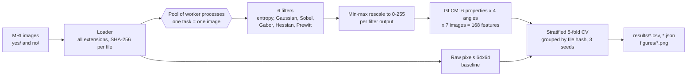
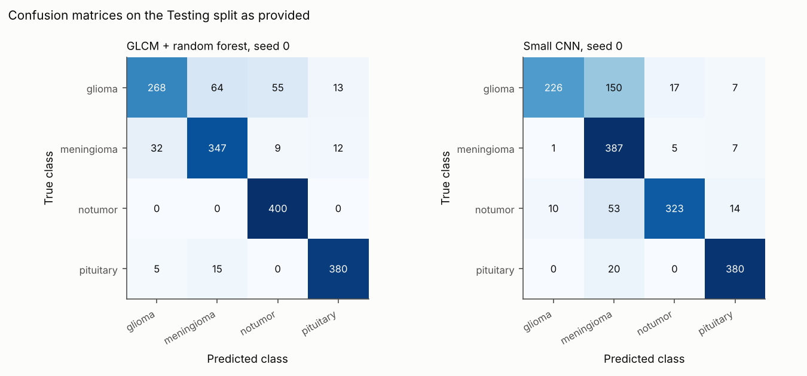

# Parallel MRI image pipeline

[](https://github.com/maryam843/parallel-mri-image-pipeline/actions/workflows/ci.yml)
<!-- While the repo is private, this badge only renders for people who have access to it. -->

Built for the DSAI3202 Parallel & Distributed Computing course at UDST.

I take brain MRI images through six image filters and a texture-feature step, run that work in parallel with Python `multiprocessing`, and measure how much faster it gets and whether the features are any good.

## In plain English

- **What it is:** a Python pipeline that loads brain MRI images, applies 6 filters to each one, turns the results into texture numbers (GLCM features), and trains simple classifiers on them.
- **The problem:** the filtering is slow, so I split the work across CPU cores. The real question is how much time that saves, and why not more.
- **How it works:** images in, then 6 filters per image in parallel worker processes, then 168 texture features per image, then cross-validated models compared with simple baselines. Out come CSV/JSON results, tables and charts.
- **Main result:** on a 4-core machine the parallel version gives identical outputs and runs 2.34x faster on the real images, and up to 3.84x when every image has the same size, because very uneven image sizes are the main limit. The texture features do not beat a simple model on raw pixels (0.734 vs 0.750 accuracy).
- **Part B:** on a larger public 4-class dataset, 542 of 1,600 Testing images have a near-duplicate candidate in Training (431 at pixel correlation >= 0.99), concentrated in the no-tumour class (358 of 400). On the provided split, GLCM + random forest reaches 0.872 accuracy and a small CNN 0.765; both are lower on the reduced test set (0.816 and 0.705), which also has a different class mix. The best filter speedup is 4.69x at 10 processes on a 6-core laptop (see [Part B](#part-b-a-larger-4-class-dataset)).
- **Why it matters:** it shows how I find the slow part of a data pipeline, parallelise it safely, and check my own numbers before quoting them.

> Demo video: **placeholder**, to be recorded by me later (under 10 MB). Until then, the walkthrough notebook `notebooks/walkthrough.ipynb` shows every step.

## Key results

| Result | Numbers | Source |
|---|---|---|
| Part A speedup (4-vCPU cloud VM, fast mode, 40 images, 4 processes) | 2.34x with native image sizes, 3.24x with images resized to 256x256 | `results/scaling_summary.csv`, `results/scaling_summary_resized_256.csv` |
| Parallel = sequential | identical outputs for every filter in every configuration, Part A and Part B | `results/parallel_equivalence*.json`, `results/part_b/parallel_equivalence.json` |
| GLCM vs raw pixels (Part A, grouped 5-fold CV x 3 seeds) | GLCM + random forest 0.734 vs raw pixels + SVM 0.750 accuracy | `results/ml_cv_summary.csv` |
| Part B leakage | 542 of 1,600 Testing images have a near-duplicate candidate in Training; no-tumour 358 of 400 | `results/part_b/leakage_by_class.json` |
| Part B accuracy (3 seeds) | provided split: GLCM + random forest 0.872, small CNN 0.765; without flagged images: 0.816 and 0.705 (different class mix) | `results/part_b/per_class_summary.csv` |
| Part B speedup (6-core laptop, 200 images at 256x256) | 4.69x at 10 processes, 3.48x at 6 | `results/part_b/scaling_summary.csv` |

## The problem

The course gave six scikit-image filters (entropy, Gaussian, Sobel, Gabor, Hessian, Prewitt) to apply to every MRI image, followed by GLCM texture features and three classifiers. With the course setting for the Hessian filter (sigmas 1-99), one image at a time takes about 35 s per image in my profile, so the whole dataset takes over an hour. The task was to make it faster with parallel processing and still get a working classifier.

## Data

- **Source:** the public Kaggle dataset "Brain MRI Images for Brain Tumor Detection" by Navoneel Chakrabarty: <https://www.kaggle.com/datasets/navoneel/brain-mri-images-for-brain-tumor-detection>. Please cite that page if you use it.
- **Size:** 253 images, 155 in `yes/` (tumour) and 98 in `no/`. Mixed file types (`.jpg`, `.JPG`, `.jpeg`, `.png`) and very different image sizes.
- **Duplicates:** 25 files are exact byte copies of other files (228 unique files, 22 duplicate groups, none across classes).
- **Licence:** the licence is not clearly stated on the source page, so **the images are not included in this repo** and are not redistributed. They are medical images, so I treat them as sensitive.
- **Get it:** download the dataset from Kaggle and put the two folders at `data/brain_tumor_dataset/yes` and `data/brain_tumor_dataset/no` (the `data/` folder is git-ignored).
- **Check your copy:** `docs/dataset_manifest.csv` lists every file name with its SHA-256 and class. Run `python -m mri_pipeline verify-data` to compare your copy with it.

## Method



1. **Profile first.** cProfile on 5 images shows where the time goes.
2. **Parallelise per image.** Each image is independent, so one task is one image with all six filters. The worker functions live in `src/mri_pipeline/`, so they also work with the `spawn` start method (Windows, macOS).
3. **Measure scaling.** A fixed, class-balanced subset of 40 unique images; sequential loop vs `Pool.map` on 1, 2, 3 and 4 processes; 3 runs each, interleaved; mean +/- sd. I also compare chunk sizes and `imap_unordered`, and check that parallel outputs are identical to sequential outputs for every filter.
4. **Evaluate the features honestly.** All 253 images, stratified 5-fold cross-validation where duplicate files always stay in the same fold, 3 seeds, three models, compared with a majority-class baseline and the same models on raw pixels.

Modes: `--fast` (default) uses Hessian sigmas 1-9; `--full` uses sigmas 1-99 as in the course setting. Every table says which mode it used. Fast mode changes the Hessian output, so fast-mode and full-mode features and timings are not the same.

## Results

All tables, charts and the full reasoning behind the numbers below are in [docs/RESULTS.md](docs/RESULTS.md).

### Where the time goes

With the course setting (Hessian sigmas 1-99), the Hessian filter takes 99.1 % of the sequential run time; even in fast mode it is the biggest stage (57.0 %). All six filters run on one image after another, so I split the work by image, not by filter. Profile tables and chart: [docs/RESULTS.md](docs/RESULTS.md#where-the-time-goes).

### Scaling


On the 4-vCPU cloud VM, `Pool.map` reaches 2.34x on 4 processes with the images at their native sizes and 3.24x when every image is resized to 256x256, so very uneven image sizes are the main limit. Chunk size 1 helps (2.88x instead of 2.38x). Full mode with equal-sized images reached 3.84x, but that was a single run on a different virtual machine, so I do not compare it directly. Parallel outputs were identical to sequential outputs for every filter in every configuration. All scaling and strategy tables, and why the speedups differ: [docs/RESULTS.md](docs/RESULTS.md#scaling).

### Classifiers vs baselines

<!-- BEGIN:ml -->
253 images, 5-fold stratified CV grouped by exact and near copies, seeds 0, 1, 2, mean +/- sd over 15 folds (`results/ml_cv_summary.csv`)

| Features | Model | Accuracy | Macro F1 | Tumour recall |
|---|---|---:|---:|---:|
| none | Majority class | 0.613 +/- 0.006 | 0.380 +/- 0.002 | 1.000 +/- 0.000 |
| raw pixels 64x64 | LogReg | 0.704 +/- 0.094 | 0.678 +/- 0.106 | 0.776 +/- 0.115 |
| raw pixels 64x64 | SVM (RBF) | 0.750 +/- 0.060 | 0.715 +/- 0.075 | 0.882 +/- 0.074 |
| raw pixels 64x64 | Random forest | 0.751 +/- 0.067 | 0.726 +/- 0.077 | 0.847 +/- 0.073 |
| GLCM, min-max rescale | LogReg | 0.726 +/- 0.074 | 0.698 +/- 0.082 | 0.834 +/- 0.068 |
| GLCM, min-max rescale | SVM (RBF) | 0.728 +/- 0.076 | 0.696 +/- 0.085 | 0.847 +/- 0.088 |
| GLCM, min-max rescale | Random forest | 0.734 +/- 0.076 | 0.712 +/- 0.080 | 0.822 +/- 0.099 |
| GLCM, direct uint8 cast (ablation) | LogReg | 0.743 +/- 0.048 | 0.715 +/- 0.055 | 0.852 +/- 0.063 |
| GLCM, direct uint8 cast (ablation) | SVM (RBF) | 0.710 +/- 0.061 | 0.675 +/- 0.063 | 0.843 +/- 0.088 |
| GLCM, direct uint8 cast (ablation) | Random forest | 0.693 +/- 0.054 | 0.665 +/- 0.056 | 0.798 +/- 0.080 |
<!-- END:ml -->

**Plain conclusion:** the GLCM texture features do **not** beat raw pixels. The best raw-pixel models (SVM 0.750, random forest 0.751) are ahead of every GLCM model (0.693 to 0.743). All models beat the majority-class baseline (0.613). The rescale ablation and the leaky cross-validation comparison are in [docs/RESULTS.md](docs/RESULTS.md#rescale-ablation-and-leaky-cross-validation).

## Part B: a larger 4-class dataset

Here I run the same pipeline on the "Brain Tumor MRI Dataset" (Version 2, Kaggle, see Credits): glioma, meningioma, pituitary and no tumour, with a Training/Testing split provided by the author. Everything ran headless on my laptop CPU through `notebooks/part_b_larger_dataset_colab.ipynb` (`python scripts/run_part_b.py`). The main result uses the provided split as it is. The same notebook still runs on Colab.

**Not a medical tool.** These are exercise models on one public dataset. Nothing here should be used to make decisions about a patient.

### Counts and duplicates

All 7,200 expected images are there. No file is shared byte for byte between Training and Testing, but 171 extra exact copies remain inside Training and 16 inside Testing. Near duplicates (dHash and pHash both within 4 bits) are the bigger issue: 542 of 1,600 Testing images have a candidate in Training, 431 of them with a pixel correlation of at least 0.99, and 358 of the 400 no-tumour test images are among them. 4 cross-split candidate pairs and 4 pairs within Testing have different class labels, which may point to labelling errors; I did not check those pairs by eye. Count, duplicate and per-class leakage tables: [docs/RESULTS.md](docs/RESULTS.md#duplicate-check).

### Speedup of the filter stage

On the 6-core laptop the pool reaches 3.48x with 6 processes and 4.69x with 10; with 12 it is a little lower (4.48x), because beyond 6 processes the workers share physical cores. This benchmark was run on its own with `python scripts/run_part_b_scaling.py`. An earlier run inside the notebook, with more programs open and less free memory, had a much larger spread at 6 to 10 processes; its files are kept in `results/part_b/scaling_first_run/`. Table and chart: [docs/RESULTS.md](docs/RESULTS.md#speedup-of-the-filter-stage).

### GLCM + random forest vs a small CNN

Both models are trained on the whole Training split and scored on the Testing split with seeds 0, 1 and 2. The CNN is small on purpose (128x128 grayscale input, 20 epochs, no validation split), so that it trains on a CPU. The second evaluation leaves out the Testing images that have a near-duplicate candidate in Training.

<!-- BEGIN:part_b_models -->
Trained on the Training split, seeds 0, 1, 2, mean +/- sd over seeds (`results/part_b/per_class_summary.csv`)

| Model | Test set | Test images | Accuracy | Macro F1 |
|---|---|---:|---:|---:|
| GLCM + random forest | Testing split as provided | 1600 | 0.872 +/- 0.002 | 0.868 +/- 0.002 |
| Small CNN | Testing split as provided | 1600 | 0.765 +/- 0.092 | 0.755 +/- 0.109 |
| GLCM + random forest | Testing without cross-split duplicate candidates | 1058 | 0.816 +/- 0.002 | 0.764 +/- 0.001 |
| Small CNN | Testing without cross-split duplicate candidates | 1058 | 0.705 +/- 0.142 | 0.692 +/- 0.132 |
<!-- END:part_b_models -->



**Plain conclusion:** on this split, my GLCM features with a random forest (0.872) beat my small CNN (0.765), and the CNN varies much more between seeds. Glioma is the hardest class for both: the random forest finds 0.673 of the glioma images and the CNN 0.601. Both models score lower on the reduced test set (0.816 and 0.705 on 1058 images), but that set is not a fair copy of the first: only 42 of the 400 no-tumour test images remain, so the drop mixes fewer near duplicates with a different class mix, and I cannot separate the two with these runs. This is a likely reason, though I have not tested it, for the random forest's 1.000 recall on no-tumour images: 358 of those 400 test images (a share of 0.895) have a near-duplicate candidate in Training (`results/part_b/leakage_by_class.json`), so many of them are close to images the model has already seen. The scores on the provided split should not be read as scores on unseen patients. I did not try a pretrained network. Per-class table, figures and step times: [docs/RESULTS.md](docs/RESULTS.md#per-class-results).

## Design choices and pitfalls handled

| Pitfall | What would go wrong | What the code does | Test |
|---|---|---|---|
| File extensions | A pattern like `glob('*.jpg')` is case-sensitive on Linux and macOS and never matches `.jpeg` or `.png`. On this dataset it would find 171 of 253 images and silently miss 82 (32 %), which also changes the class balance. | Checks the lower-cased extension and hashes every file. | `tests/test_io.py` |
| Duplicate files | 25 files are exact copies, so a random split can put a copy on each side and inflate the scores. | `StratifiedGroupKFold` with the file hash as the group. | `tests/test_train.py` (includes a property test) |
| Rescaling filter outputs | A direct cast `(image * 255).astype(np.uint8)` inverts uint8 images (200 becomes 56) and wraps float outputs above 1 (entropy 3.7 becomes 175). | Min-max rescale of each filter output to 0-255; the direct cast is kept only for the ablation. | `tests/test_filters_features.py` (includes a property test) |
| One small split | A single small test split moves by several points when one image changes, and gives no spread. | 5-fold cross-validation x 3 seeds, every shuffle seeded, with baselines. | `tests/test_cli_integration.py` (same seed gives identical results) |
| Spawn start method | Worker functions defined inside a notebook only work with `fork` (Linux). | Workers live in `src/`; scripts use `__main__` guards. | `tests/test_parallel.py` |
| Hand-typed numbers | A number typed into the README can drift from the measurement. | The tables in the README and `docs/RESULTS.md` are generated from `results/`; `scripts/check_readme_claims.py` fails on any number in either file that is not found there. | CI job |

## Limitations

- Small dataset (253 images, 228 unique). Differences of a few points between models are within the fold-to-fold spread.
- **Not a clinical tool.** Nothing here should be used to make decisions about a patient.
- Timings are machine-specific, and two kinds of machine were used. Part A ran on 4-vCPU cloud virtual machines: the fast-mode runs and the full-mode scaling runs came from two different CPU models, so they were not the same machine. They report 1 thread per core, but I cannot see how their cores map to physical hardware. Part B ran on a 6-core laptop (12 logical cores).
- Fast mode (Hessian sigmas 1-9) is not the same computation as full mode; the full-mode numbers come from a 16-image subset and a single run.
- The Gabor filter runs on uint8 input and returns uint8, so its negative responses wrap. I kept the course filter settings unchanged and documented it in `docs/DECISIONS.md`.
- I did not try a CNN on the 253-image dataset. Part B has a small CNN baseline on the larger dataset, trained from scratch on a CPU; it is a baseline, not a tuned model.
- Part B uses one provided split and three seeds, so the spread shows training noise only, not how the scores would change on another split or on scans from another hospital. The Part B speedup comes from a separate re-run of the benchmark; the first, noisier run (inside the notebook, with more programs open) is kept in `results/part_b/scaling_first_run/`. The other Part B timings come from the notebook run, with other programs open on the laptop.

## What I learned (to be written by me)

## How to run

Python 3.12. From the repository root:

```bash
python -m venv .venv
source .venv/bin/activate            # Windows: .venv\Scripts\activate
pip install -r requirements-dev.txt
pip install -e . --no-deps
```

Without the real data (synthetic images, works anywhere):

```bash
python -m mri_pipeline make-synthetic --out data_synthetic --per-class 8
python -m mri_pipeline run-scaling --data-dir data_synthetic --out-dir results/scratch --images 8 --processes 1 2 --repeats 1
python -m mri_pipeline run-ml --fast --data-dir data_synthetic --out-dir results/scratch --seeds 0 --folds 3
```

With the real data in `data/brain_tumor_dataset/` (this reproduces `results/`):

```bash
python -m mri_pipeline verify-data
python -m mri_pipeline inventory --write-manifest docs/dataset_manifest.csv
python -m mri_pipeline profile --fast --images 5
python -m mri_pipeline profile --full --images 5
python -m mri_pipeline run-scaling --fast --images 40 --processes 1 2 3 4 --repeats 3
python -m mri_pipeline run-scaling --fast --images 40 --processes 1 2 3 4 --repeats 3 --no-strategies --resize 256 --tag resized_256
python -m mri_pipeline run-scaling --fast --images 40 --processes 1 2 3 4 --repeats 3 --no-strategies --task features --tag features_task
python -m mri_pipeline run-ml --fast --seeds 0 1 2
python -m mri_pipeline run-scaling --full --images 16 --processes 1 2 3 4 --repeats 1 --no-strategies --resize 256 --tag full_resized_256
python -m mri_pipeline run-scaling --full --images 16 --processes 1 2 3 4 --repeats 1 --no-strategies --tag full_subset
python scripts/make_figures.py
python scripts/update_readme_tables.py
```

Part B (download the dataset from Kaggle first, read its licence, keep it outside the repo). The CNN needs PyTorch from `requirements-part-b.txt`, which `requirements-dev.txt` already includes; on Linux add `--extra-index-url https://download.pytorch.org/whl/cpu` to get the CPU build:

```bash
export MRI_PART_B_LICENCE=CC-BY-4.0                # confirms you have read the licence
export MRI_PART_B_DATA_DIR=/path/to/archive        # the folder with Training/ and Testing/
python scripts/run_part_b.py                       # writes results/part_b/ and figures/part_b/
python scripts/check_duplicate_candidates.py       # pixel check of the near-duplicate candidates
python scripts/run_part_b_scaling.py               # re-run only the speedup benchmark
```

The walkthrough notebook runs on synthetic images by default. To execute it and save its outputs:

```bash
python scripts/run_walkthrough.py                       # synthetic images
MRI_USE_REAL_DATA=1 python scripts/run_walkthrough.py   # real images in data/
```

Checks:

```bash
pytest                                        # all tests
MRI_START_METHOD=spawn pytest                 # force the spawn start method
pytest --cov --cov-fail-under=85              # coverage of src/
ruff check . && ruff format --check .
python scripts/check_readme_claims.py         # every number in README.md and docs/RESULTS.md is in results/
python scripts/pii_scan.py --history          # secrets / personal data in the whole history
```

`python -m mri_pipeline --help` lists every command. The `scripts/run_scaling.py` and `scripts/run_ml.py` wrappers take the same options.

## Credits

- **Course staff, DSAI3202 (UDST):** the six filter calls and their parameters, and the `compute_glcm_features` helper. `src/mri_pipeline/filters.py` and the GLCM part of `src/mri_pipeline/features.py` are based on them, and the header of each file says "Provided by DSAI3202 course staff (UDST). Modified by me: yes" and what I changed.
- **My own work:** the parallel pipeline, the experiments, the evaluation, the tests, the scripts, the notebooks and the documentation.
- **Dataset:** Navoneel Chakrabarty, "Brain MRI Images for Brain Tumor Detection", Kaggle (not redistributed here).
- **Part B dataset:** "Brain Tumor MRI Dataset" by Masoud Nickparvar, Kaggle, Version 2: <https://www.kaggle.com/datasets/masoudnickparvar/brain-tumor-mri-dataset>. Licence: CC BY 4.0 (<https://creativecommons.org/licenses/by/4.0/>). The author built it from three source datasets: figshare, SARTAJ and Br35H. The images are not redistributed here; resizing and normalisation are done by my code.
- **Libraries:** NumPy, SciPy, scikit-image, scikit-learn, OpenCV, matplotlib, PyTorch (Part B).

## Licence

My code is under the MIT licence (`LICENSE`). Course-provided parts remain the work of their authors (see Credits). The datasets are not part of this repo and are not covered by the licence.
