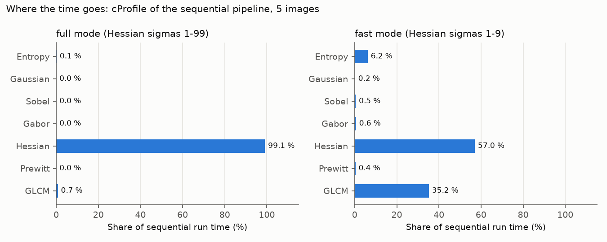
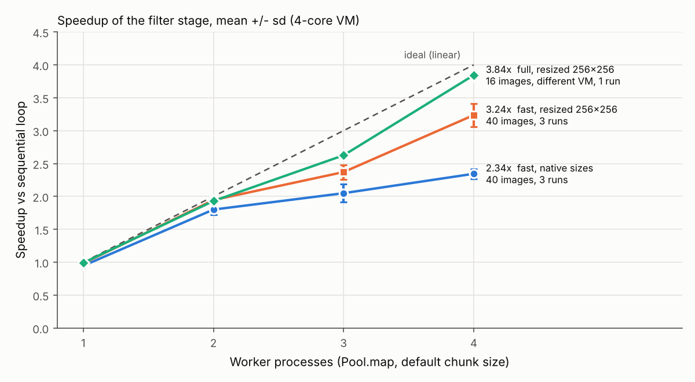
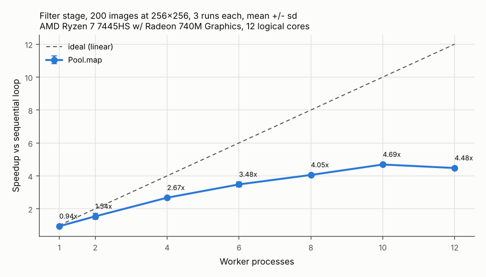
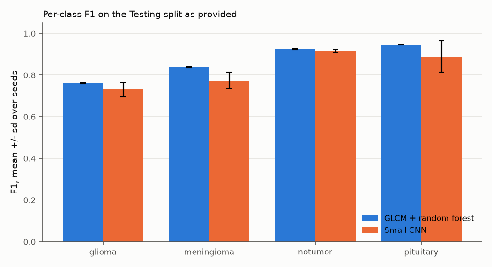
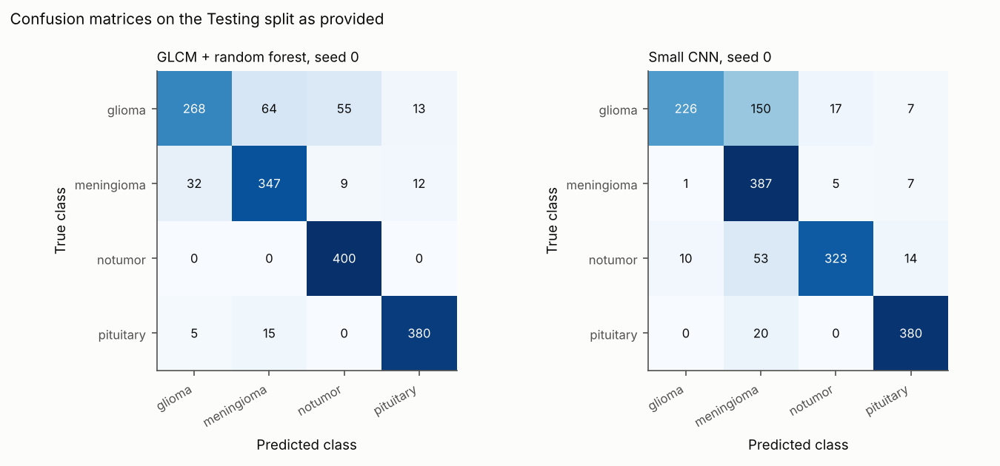
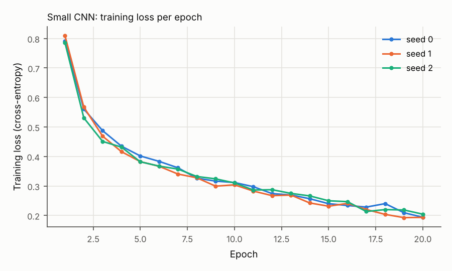

# Detailed results

Every table here is generated from the files in `results/` by `scripts/update_readme_tables.py`, and `scripts/check_readme_claims.py` checks every table and number against those files. The short version is in the [README](../README.md).

## Part A: the 253-image dataset (4-vCPU cloud VM)

### Where the time goes

<!-- BEGIN:profile_full -->
Sequential pipeline, 5 images, full mode, cProfile cumulative time (`results/profile_full.csv`)

| Stage | Total (s) | Per image (s) | Share |
|---|---:|---:|---:|
| Entropy | 0.26 | 0.05 | 0.1 % |
| Gaussian | 0.01 | 0.00 | 0.0 % |
| Sobel | 0.02 | 0.00 | 0.0 % |
| Gabor | 0.03 | 0.01 | 0.0 % |
| Hessian | 171.73 | 34.35 | 99.1 % |
| Prewitt | 0.02 | 0.00 | 0.0 % |
| GLCM (7 filtered images x 24 features per image) | 1.27 | 0.25 | 0.7 % |
| Other (loop, dict building, profiler overhead) | 0.00 | 0.00 | 0.0 % |
| **Total** | 173.33 | 34.67 | 100.0 % |
<!-- END:profile_full -->

<!-- BEGIN:profile_fast -->
Sequential pipeline, 5 images, fast mode, cProfile cumulative time (`results/profile_fast.csv`)

| Stage | Total (s) | Per image (s) | Share |
|---|---:|---:|---:|
| Entropy | 0.26 | 0.05 | 6.2 % |
| Gaussian | 0.01 | 0.00 | 0.2 % |
| Sobel | 0.02 | 0.00 | 0.5 % |
| Gabor | 0.03 | 0.01 | 0.6 % |
| Hessian | 2.37 | 0.47 | 57.0 % |
| Prewitt | 0.01 | 0.00 | 0.4 % |
| GLCM (7 filtered images x 24 features per image) | 1.46 | 0.29 | 35.2 % |
| Other (loop, dict building, profiler overhead) | 0.00 | 0.00 | 0.0 % |
| **Total** | 4.15 | 0.83 | 100.0 % |
<!-- END:profile_fast -->

With the original setting of sigmas 1-99, the Hessian filter takes 99.1 % of the time. Even in fast mode it is the biggest stage (57.0 %). All six filters run on the same image one after another, so splitting the work by image (not by filter) keeps every worker busy with one whole image.

### Scaling

<!-- BEGIN:scaling -->
Task `filters`: 40 images, fast mode, native sizes, largest image = 18.2 % of all pixels, 3 run(s) each, 4 cores (Intel(R) Xeon(R) Processor @ 2.80GHz), start method `fork` (`results/scaling_summary.csv`)

| Configuration | Processes | Time (s), mean +/- sd | Speedup | Efficiency |
|---|---:|---:|---:|---:|
| Sequential loop (no pool) | 1 | 42.46 +/- 0.88 | 1.00x | 1.00 |
| Pool.map | 1 | 44.93 +/- 2.06 | 0.95x +/- 0.04 | 0.95 |
| Pool.map | 2 | 23.62 +/- 1.02 | 1.80x +/- 0.08 | 0.90 |
| Pool.map | 3 | 20.78 +/- 1.45 | 2.05x +/- 0.14 | 0.68 |
| Pool.map | 4 | 18.13 +/- 0.59 | 2.34x +/- 0.08 | 0.59 |
<!-- END:scaling -->

On the images at their native sizes, `Pool.map` reaches 2.34x on 4 processes (efficiency 0.59). A pool with one process is slower than the plain loop (0.95x): that is the cost of starting the pool and sending seven filtered arrays per image back to the parent. The bigger limit is that the images have very different sizes. In this subset the largest image alone has 18.2 % of all pixels, so the work cannot be split into four equal parts.

<!-- BEGIN:strategies -->
| Strategy | Processes | Chunk size used | Time (s), mean +/- sd | Speedup |
|---|---:|---:|---:|---:|
| Pool.map, chunksize auto | 4 | 3 | 17.83 +/- 0.27 | 2.38x |
| Pool.map, chunksize 1 | 4 | 1 | 14.72 +/- 0.08 | 2.88x |
| imap_unordered, chunksize 1 | 4 | 1 | 14.93 +/- 0.14 | 2.84x |
| imap_unordered, chunksize auto | 4 | 3 | 17.95 +/- 0.27 | 2.37x |
<!-- END:strategies -->

The chunk size matters more than `map` vs `imap_unordered`. With 40 images and 4 processes, `Pool.map` sends chunks of 3 images, so one worker can get several big images while the others finish early and wait. With chunksize 1, each worker takes the next image as soon as it is free: 2.88x instead of 2.38x. `imap_unordered` with the same chunk size gives about the same speed (2.84x); it only changes the order in which results come back.

Two extra runs separate the causes. First, the same 40 images resized to 256x256, so every task is the same size. Second, a worker that also does the GLCM step and returns only 168 numbers per image instead of seven arrays:

<!-- BEGIN:scaling_resized_256 -->
Task `filters`: 40 images, fast mode, resized to 256x256, largest image = 2.5 % of all pixels, 3 run(s) each, 4 cores (Intel(R) Xeon(R) Processor @ 2.80GHz), start method `fork` (`results/scaling_summary_resized_256.csv`)

| Configuration | Processes | Time (s), mean +/- sd | Speedup | Efficiency |
|---|---:|---:|---:|---:|
| Sequential loop (no pool) | 1 | 14.35 +/- 0.08 | 1.00x | 1.00 |
| Pool.map | 1 | 14.61 +/- 0.12 | 0.98x +/- 0.01 | 0.98 |
| Pool.map | 2 | 7.38 +/- 0.07 | 1.95x +/- 0.02 | 0.97 |
| Pool.map | 3 | 6.06 +/- 0.29 | 2.37x +/- 0.11 | 0.79 |
| Pool.map | 4 | 4.44 +/- 0.23 | 3.24x +/- 0.18 | 0.81 |
<!-- END:scaling_resized_256 -->

<!-- BEGIN:scaling_features_task -->
Task `features`: 40 images, fast mode, native sizes, largest image = 18.2 % of all pixels, 3 run(s) each, 4 cores (Intel(R) Xeon(R) Processor @ 2.80GHz), start method `fork` (`results/scaling_summary_features_task.csv`)

| Configuration | Processes | Time (s), mean +/- sd | Speedup | Efficiency |
|---|---:|---:|---:|---:|
| Sequential loop (no pool) | 1 | 52.48 +/- 1.04 | 1.00x | 1.00 |
| Pool.map | 1 | 52.73 +/- 0.95 | 0.99x +/- 0.02 | 0.99 |
| Pool.map | 2 | 27.88 +/- 0.56 | 1.88x +/- 0.04 | 0.94 |
| Pool.map | 3 | 23.75 +/- 0.69 | 2.21x +/- 0.06 | 0.74 |
| Pool.map | 4 | 20.48 +/- 0.17 | 2.56x +/- 0.02 | 0.64 |
<!-- END:scaling_features_task -->

With equal-sized images the pool reaches 3.24x on 4 processes, so uneven image sizes cost the most. Returning 168 numbers instead of seven arrays brings the one-process pool to 0.99x of the plain loop (instead of 0.95x) and gives 2.56x at 4 processes, but the unequal image sizes still limit it.

Full mode (Hessian sigmas 1-99) on a 16-image subset, one run each (this takes about an hour, so I did not repeat it):

<!-- BEGIN:scaling_full_subset -->
Task `filters`: 16 images, full mode, native sizes, largest image = 46.1 % of all pixels, 1 run(s) each, 4 logical cores, 4 physical (Intel(R) Xeon(R) Processor @ 2.80GHz), start method `fork` (`results/scaling_summary_full_subset.csv`)

| Configuration | Processes | Time (s), mean +/- sd | Speedup | Efficiency |
|---|---:|---:|---:|---:|
| Sequential loop (no pool) | 1 | 1395.55 (1 run) | 1.00x | 1.00 |
| Pool.map | 1 | 1414.13 (1 run) | 0.99x (1 run) | 0.99 |
| Pool.map | 2 | 936.74 (1 run) | 1.49x (1 run) | 0.74 |
| Pool.map | 3 | 854.38 (1 run) | 1.63x (1 run) | 0.54 |
| Pool.map | 4 | 734.73 (1 run) | 1.90x (1 run) | 0.47 |
<!-- END:scaling_full_subset -->

<!-- BEGIN:scaling_full_resized_256 -->
Task `filters`: 16 images, full mode, resized to 256x256, largest image = 6.2 % of all pixels, 1 run(s) each, 4 cores (Intel(R) Xeon(R) Processor @ 2.10GHz), start method `fork` (`results/scaling_summary_full_resized_256.csv`)

| Configuration | Processes | Time (s), mean +/- sd | Speedup | Efficiency |
|---|---:|---:|---:|---:|
| Sequential loop (no pool) | 1 | 215.81 (1 run) | 1.00x | 1.00 |
| Pool.map | 1 | 218.06 (1 run) | 0.99x (1 run) | 0.99 |
| Pool.map | 2 | 111.85 (1 run) | 1.93x (1 run) | 0.96 |
| Pool.map | 3 | 82.22 (1 run) | 2.62x (1 run) | 0.88 |
| Pool.map | 4 | 56.15 (1 run) | 3.84x (1 run) | 0.96 |
<!-- END:scaling_full_resized_256 -->

In full mode each image does much more work for every byte sent back, so pool overhead almost disappears. With equal-sized images, 4 processes give 3.84x (efficiency 0.96). With native sizes, the same 16 images give only 1.90x, because one image (1427x1275 pixels) has 46.1 % of all pixels and a pool cannot finish before its biggest task.

Why the speedups differ: 2.34x and 3.84x differ in four ways at once. First, the mix of image sizes: 2.34x (`results/scaling_summary.csv`) uses images at their native, very different sizes, and the largest one alone has 18.2 % of all pixels (`results/scaling_meta.json`). Each task is one whole image, so the pool cannot finish before that image is done. 3.84x uses images resized to 256x256, so every task costs about the same. Second, the mode: 2.34x is fast mode (Hessian sigmas 1-9) and 3.84x is full mode (sigmas 1-99), so each task does far more work in full mode and the cost of starting the pool and sending results back is a smaller share of the total. Third, the image count: 40 images vs 16. Fourth, the machine: the fast-mode scaling tables (and both profiles) ran on `Intel(R) Xeon(R) Processor @ 2.80GHz`, the two full-mode scaling tables on `Intel(R) Xeon(R) Processor @ 2.10GHz` (`machine.cpu_model` in `results/scaling_meta.json`, `results/scaling_meta_resized_256.json`, `results/scaling_meta_full_resized_256.json` and `results/scaling_meta_full_subset.json`). Both were 4-vCPU cloud virtual machines, but not the same one. The fast-mode run on the same 40 images resized to 256x256 (`results/scaling_summary_resized_256.csv`) keeps the mode, the image count and the CPU model the same and gives 3.24x. Resizing also makes each image smaller, so that step changes the size mix and the work per task together; even so, the speedup went up although each task got cheaper, which points to the uneven sizes. The step from 3.24x to 3.84x changes the mode, the image count and the machine together, and I have no run that separates those effects, so I cannot say how much of that step comes from full mode itself. Also, 3.84x (`results/scaling_summary_full_resized_256.csv`) is a single run per configuration: the file has runs = 1, so its table says "1 run" instead of giving a spread. 2.34x and 3.24x are means of 3 runs.

Parallel outputs were identical to sequential outputs (`np.array_equal` and `np.allclose`) for every filter in every configuration (`results/parallel_equivalence*.json`).

### Rescale ablation and leaky cross-validation

The cross-validation table itself is in the [README](../README.md#classifiers-vs-baselines).

Rescale ablation (direct uint8 cast vs per-filter min-max): the rows marked "direct uint8 cast (ablation)" feed the GLCM step with `(image * 255).astype(np.uint8)` instead of the min-max rescale. Min-max is ahead for the SVM (0.737 vs 0.717) and the random forest (0.752 vs 0.721) but not for logistic regression (0.747 vs 0.759), and all those differences are inside one standard deviation.

How much the duplicate files would have flattered the scores (same models, plain stratified folds that ignore duplicates):

<!-- BEGIN:leakage -->
| Features | Model | Accuracy, grouped CV | Accuracy, leaky CV | Difference |
|---|---|---:|---:|---:|
| raw pixels 64x64 | LogReg | 0.757 | 0.761 | +0.004 |
| raw pixels 64x64 | SVM (RBF) | 0.803 | 0.809 | +0.006 |
| raw pixels 64x64 | Random forest | 0.799 | 0.820 | +0.020 |
| GLCM, min-max rescale | LogReg | 0.747 | 0.740 | -0.007 |
| GLCM, min-max rescale | SVM (RBF) | 0.737 | 0.744 | +0.008 |
| GLCM, min-max rescale | Random forest | 0.752 | 0.776 | +0.024 |
| GLCM, direct uint8 cast (ablation) | LogReg | 0.759 | 0.768 | +0.009 |
| GLCM, direct uint8 cast (ablation) | SVM (RBF) | 0.717 | 0.727 | +0.010 |
| GLCM, direct uint8 cast (ablation) | Random forest | 0.721 | 0.748 | +0.028 |
<!-- END:leakage -->

The random forest gains the most from leaked duplicates (see the Difference column), because it can memorise an exact copy it saw in training.

## Part B: the larger 4-class dataset

**Not a medical tool.** These are exercise models on one public dataset. Nothing here should be used to make decisions about a patient.

### Count check

<!-- BEGIN:part_b_counts -->
Images found vs expected: 7200 of 7200, differences: 0 (`results/part_b/dataset_counts.json`)

| Split | glioma | meningioma | notumor | pituitary | Total |
|---|---:|---:|---:|---:|---:|
| Training | 1400 | 1400 | 1400 | 1400 | 5600 |
| Testing | 400 | 400 | 400 | 400 | 1600 |
<!-- END:part_b_counts -->

### Duplicate check

The dataset page says duplicates were removed and the train/test overlap was eliminated. I checked both. Exact copies use SHA-256 of the file bytes. Near duplicates use two 64-bit perceptual hashes (dHash and pHash); a pair is a candidate when both hashes are within 4 bits.

<!-- BEGIN:part_b_duplicates -->
64-bit perceptual hashes, pairs counted by Hamming distance (`results/part_b/duplicates.json`)

| Check | Within Training | Within Testing | Across splits |
|---|---:|---:|---:|
| Exact copies (SHA-256): extra copies inside the split | 171 | 16 | n/a |
| Exact copies (SHA-256): Testing files with a copy in Training | n/a | n/a | 0 |
| dHash pairs within 4 bits | 9325 | 884 | 4990 |
| pHash pairs within 4 bits | 3432 | 416 | 2022 |
| Candidate pairs (dHash and pHash both within 4 bits) | 2620 | 354 | 1658 |
| Candidate pairs with different class labels | 0 | 4 | 4 |
| Testing images with a candidate in Training | n/a | n/a | 542 |
<!-- END:part_b_duplicates -->

<!-- BEGIN:part_b_leakage -->
Testing images with a cross-split near-duplicate candidate, per class (`results/part_b/leakage_by_class.json`)

| Class | Testing images | With a candidate in Training | Share | Of those, pixel r >= 0.99 |
|---|---:|---:|---:|---:|
| glioma | 400 | 27 | 0.068 | 7 |
| meningioma | 400 | 125 | 0.312 | 103 |
| notumor | 400 | 358 | 0.895 | 321 |
| pituitary | 400 | 32 | 0.080 | 0 |
| **all** | 1600 | 542 | 0.339 | 431 |
<!-- END:part_b_leakage -->

No file is shared byte for byte between Training and Testing, but 171 extra exact copies remain inside Training and 16 inside Testing. The near-duplicate check finds much more: 542 Testing images have a candidate in Training. To make sure these are not just hash collisions, I compared every candidate pair pixel by pixel at 128x128 (`scripts/check_duplicate_candidates.py`, `results/part_b/duplicate_candidates_pixel.json`): across the splits the median correlation of a pair is 0.9956, and 431 Testing images have a Training partner with a correlation of at least 0.99. I also looked at 2 pairs by eye: the median pair looks like the same image, and the weakest across-split pair looks like a neighbouring slice of the same scan. 4 cross-split candidate pairs and 4 pairs within Testing have different class labels, which may point to labelling errors; I did not check those pairs by eye. So exact copies across the split are gone, but a lot of near-duplicate overlap between Training and Testing remains.

### Speedup of the filter stage

<!-- BEGIN:part_b_scaling -->
Task `filters`: 200 images, fast mode, resized to 256x256, largest image = 0.5 % of all pixels, 3 run(s) each, 12 logical cores, 6 physical (AMD Ryzen 7 7445HS w/ Radeon 740M Graphics), start method `spawn` (`results/part_b/scaling_summary.csv`)

| Configuration | Processes | Time (s), mean +/- sd | Speedup | Efficiency |
|---|---:|---:|---:|---:|
| Sequential loop (no pool) | 1 | 78.33 +/- 5.97 | 1.00x | 1.00 |
| Pool.map | 1 | 83.45 +/- 4.73 | 0.94x +/- 0.05 | 0.94 |
| Pool.map | 2 | 51.28 +/- 5.70 | 1.54x +/- 0.18 | 0.77 |
| Pool.map | 4 | 29.32 +/- 0.78 | 2.67x +/- 0.07 | 0.67 |
| Pool.map | 6 | 22.53 +/- 1.08 | 3.48x +/- 0.17 | 0.58 |
| Pool.map | 8 | 19.32 +/- 0.15 | 4.05x +/- 0.03 | 0.51 |
| Pool.map | 10 | 16.71 +/- 0.12 | 4.69x +/- 0.03 | 0.47 |
| Pool.map | 12 | 17.50 +/- 0.13 | 4.48x +/- 0.03 | 0.37 |
<!-- END:part_b_scaling -->

This benchmark was run on its own with `python scripts/run_part_b_scaling.py`, using the notebook's settings; the total and free memory at the start are in `results/part_b/scaling_environment.json`. On this laptop the pool reaches 3.48x with 6 processes, one per physical core, and 4.69x with 10. With 12 it is a little lower (4.48x): beyond 6 processes the workers share physical cores, so each extra process adds less. Each worker gets one BLAS thread (see `docs/DECISIONS.md`). Parallel outputs were identical to sequential outputs (`results/part_b/parallel_equivalence.json`). An earlier run inside the notebook, with more programs open and less free memory, had a much larger spread at 6 to 10 processes; its files are kept in `results/part_b/scaling_first_run/`.

### Per-class results

<!-- BEGIN:part_b_per_class -->
Testing split as provided, mean +/- sd over seeds (`results/part_b/per_class_summary.csv`)

| Model | Class | Precision | Recall | F1 | Support |
|---|---|---:|---:|---:|---:|
| GLCM + random forest | glioma | 0.880 +/- 0.005 | 0.673 +/- 0.006 | 0.763 +/- 0.006 | 400 |
| GLCM + random forest | meningioma | 0.814 +/- 0.006 | 0.864 +/- 0.003 | 0.838 +/- 0.004 | 400 |
| GLCM + random forest | notumor | 0.863 +/- 0.003 | 1.000 +/- 0.000 | 0.926 +/- 0.002 | 400 |
| GLCM + random forest | pituitary | 0.938 +/- 0.002 | 0.951 +/- 0.004 | 0.944 +/- 0.003 | 400 |
| Small CNN | glioma | 0.974 +/- 0.019 | 0.601 +/- 0.069 | 0.742 +/- 0.052 | 400 |
| Small CNN | meningioma | 0.564 +/- 0.108 | 0.931 +/- 0.035 | 0.699 +/- 0.096 | 400 |
| Small CNN | notumor | 0.876 +/- 0.058 | 0.927 +/- 0.103 | 0.896 +/- 0.028 | 400 |
| Small CNN | pituitary | 0.972 +/- 0.036 | 0.601 +/- 0.385 | 0.683 +/- 0.327 | 400 |
<!-- END:part_b_per_class -->

### Step times

<!-- BEGIN:part_b_times -->
Wall-clock time of each step in one run of the notebook (`results/part_b/run_info.json`)

| Step | Time (s) |
|---|---:|
| Count check (list and SHA-256 every file) | 1.3 |
| Duplicate check (perceptual hashes and pair search) | 3.7 |
| Speedup benchmark (all configurations and repeats) | 643.9 |
| GLCM features for all images (parallel) | 1132.4 |
| Random forest, fit and predict (all seeds) | 11.5 |
| Small CNN, load, train and predict (all seeds) | 2171.3 |
<!-- END:part_b_times -->
